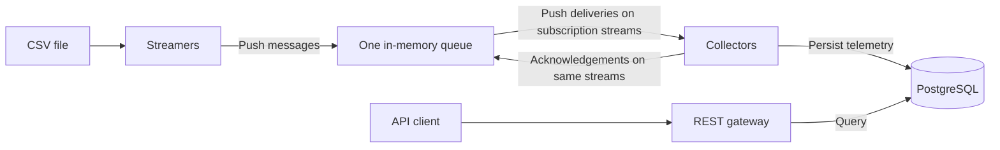
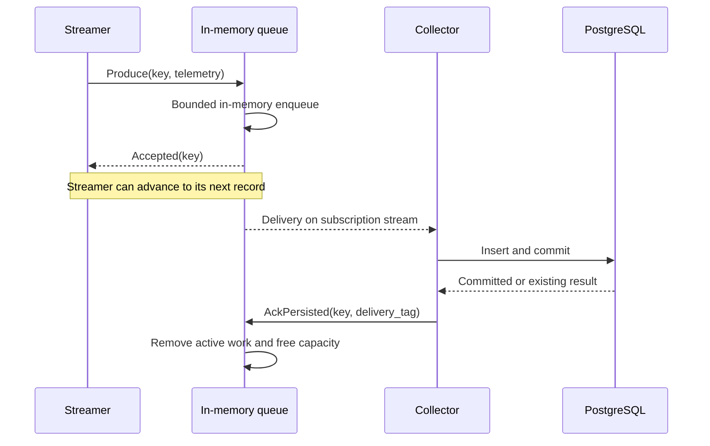

# GPU Telemetry Pipeline Design

GPU Telemetry Pipeline is an elastic, scalable and stable telemetry pipeline for an AI Cluster with messaging queue. The pipeline streams GPU telemetry messages from a streamer service to a custom message queue. The queue then streams these messages to the collector service which has the responsibility to persist them in a database for future access. A gateway service exposes the telemetry data persisted via REST APIs.

## Requirements and scope

The table below lists the functional requirements for the pipeline.

| ID | PDF functional requirement |
| --- | --- |
| F1 | Read CSV telemetry and stream it periodically through a custom queue. |
| F2 | Each CSV record is an independent datapoint; looping may simulate continuous telemetry. |
| F3 | Use the time a telemetry log is processed as its timestamp. |
| F4 | Dynamically scale streamers up/down. |
| F5 | Collectors consume, parse, and persist telemetry. |
| F6 | Dynamically scale collectors up/down. |
| F7 | Implement custom messaging queue connecting streamers and collectors, as a library or service. |
| F8 | List GPUs for which telemetry exists by unique UUIDs. |
| F9 | Return all telemetry for a GPU, ordered by time. |
| F10 | Optional inclusive `start_time` and `end_time` filters. |
| F11 | Automatically generate REST OpenAPI and expose a Make generation command. |

Required constraints/deliverables: Go, Docker, Kubernetes, Helm, custom queue rather than an existing MQ, full source, unit tests, Dockerfiles, Helm charts, generated OpenAPI, comprehensive README and Make-based coverage measurement/display. The exercise bounds streamer/collector scaling at ten instances; validate up to ten of each. Its success criteria include maintainability and graceful error/memory handling and invite observability.

Push delivery and in-memory queueing are the selected mechanisms. Durability of queue contents, queue replication, time-series extensions, retention policies, partitions, topics, fan-out, and numeric performance/availability targets are not requirements and not in scope of this design. Availability is still considered, with the single queue's failure limits.

## Architecture and communication



**gRPC bidirectional streams** are used for the internal links. Each streamer initiates a producer connection and each collector initiates a subscription connection to the queue's Kubernetes Service. The queue sends deliveries back on the collector's existing connection. Client-initiated connection establishment does not make delivery a polling model.

The queue distributes work, not broadcasts: one delivery goes to one available collector. Each collector has one processing worker and configurable `COLLECTOR_SLOTS`, default 1. Slots cover processing plus buffered assignments and its input channel has capacity `slots - 1`. The queue enforces a configurable maximum. Each streamer keeps one message awaiting queue acceptance. Batching or additional workers are deferred. Increasing slots changes buffering, not processing parallelism.

## Data and timestamps

The supplied fixture contains 2,470 records, 247 unique GPU UUIDs, 31 hosts, and ten metrics. `gpu_id` is host-local and repeats across hosts, so the public GPU identifier is the full `uuid` string. Empty `container`, `pod`, and `namespace` values are valid. The payload retains the CSV's twelve fields: `timestamp`, `metric_name`, `gpu_id`, `device`, `uuid`, `modelName`, `Hostname`, `container`, `pod`, `namespace`, `value`, and `labels_raw`. 

The streamer **overwrites `timestamp` with its current UTC processing time** before the first send. There is one telemetry timestamp and the original CSV timestamp is not retained. A retry of the same logical message keeps the same timestamp and payload and the next row or replay loop gets a new processing time.

### Minimal retry identity

A stable identity is necessary only because retries can occur after an uncertain response. It is achieved by an internal transport metadata, not a new telemetry feature:

- `streamer_session`: a random identifier generated once when a streamer process starts, retained across reconnects.
- `sequence`: an increasing integer assigned by that streamer to each new record/replay occurrence, retained on retry.

Together they form `MessageKey`. A new streamer process starts a new session, so restarting a CSV replay intentionally creates new occurrences. The queue deduplicates active messages by key alone and retains the first accepted payload. The streamer must preserve that payload and key when retrying. Importantly, the queue does not compare content on duplicate keys.

The queue's FIFO data structure records local acceptance order. A collector delivery carries a `delivery_tag` allocated from a queue-local counter, plus connection ownership, so late acknowledgements cannot complete reassigned work. Increment the counter once per dispatch inside the event loop; never reuse a tag during that queue process. This tag correlates acknowledgements and cannot detect producer retries. Old connections cannot acknowledge work after a queue process restart.

### Sequence number overflow guard

Use a signed 64-bit integer for `sequence`, consistently in Go (`int64`), the internal protocol (`int64`), and PostgreSQL (`BIGINT`). Valid allocated values are **1 through 9,223,372,036,854,775,807**. Zero is the unallocated starting state and is invalid on the wire and nonpositive or out-of-range input are rejected. Choosing the storage-compatible range avoids accepting a larger unsigned value that cannot be persisted. Limit is checked **before** incrementing, inside the counter's single owner. The streamer send loop owns its producer sequence and the broker event loop owns its delivery-tag counter. If there would be a sequence number exhaustion scenario which is unlikely, `sequence_exhausted` error will be surfaced.

## Telemetry streamer

Each instance reads its configured CSV independently, maps the columns, overwrites `timestamp`, allocates the next `MessageKey`, and pushes an envelope. Numeric telemetry parsing remains in the collector. There is no distributed CSV partitioning or durable source checkpoint in the brief.

A producer envelope contains `MessageKey` and the record payload. A producer acceptance reply means **accepted into queue memory**, not written to disk or already collected. The streamer waits for that explicit reply before advancing. A successful gRPC `Send` alone is not application acceptance.

If the queue reports full, wait with capped backoff and retry the same message. If the connection breaks before acceptance is known, reconnect and retry the same key, timestamp, and payload. Validate permanent input/protocol errors and report them explicitly rather than silently advancing. On shutdown, reading is stopped and an attempt to resolve the pending send is made within the shutdown deadline. A killed streamer has no recovery log.

## In-memory queue service

### Protocol

Two internal RPCs are kept in a small project-owned `.proto` contract:

| RPC | Client sends | Queue sends |
| --- | --- | --- |
| `Produce` | Stream of keyed telemetry records | Acceptance, duplicate, full, or invalid result correlated to the key. |
| `Subscribe` | Initial subscription, then `AckPersisted`, transient `Retry`, or permanent `Reject` for a delivery | Deliveries containing key, payload, and delivery tag. |

A subscriber advertises its configured slot count, default one. Completing a current delivery makes that slot available automatically. No per-message poll, renewal API, arbitrary credit protocol, or separate subscription service is needed. A reconnect is a new subscriber connection.

### Acknowledgement and retry ownership

The queue sends `Accepted` immediately after accepting the message into memory, independently of whether a collector is connected or has persisted it. It must not defer producer acceptance until a collector ack arrives.



Retries belong to the handoff whose result is uncertain. The streamer retries only until it knows queue acceptance; after that it releases its pending record and does not wait for, track, or retry collector/database completion. The queue owns subsequent collector redelivery while it remains running. Collector/database uncertainty is resolved with the same stable key, never by generating a new producer event. There is no additional end-to-end retry protocol.

### In-memory state

Use one broker event loop to own all mutable queue state. Transport reader/writer goroutines submit commands through a bounded Go channel, they do not mutate the data structures directly. This provides process-local thread safety without database locking or a distributed coordinator.

| Structure | Contents and purpose |
| --- | --- |
| `ready *list.List` | Doubly linked FIFO list holding `*entry` values. Enqueue/requeue use `PushBack`; dispatch removes `Front`. |
| `active map[telemetry.Key]*entry` | Every unfinished entry, both ready and assigned. Each entry holds its envelope, accounted size, owner subscription ID, delivery tag, and deadline. Active keys recognize producer retries. |
| `subscribers []*subscriber` and round-robin cursor | Slice of live subscriber pointers, each with a slot limit, cancellation handle, and bounded outbound delivery channel. |
| Per-subscriber `assignments map[telemetry.Key]*entry` | Entries assigned to that subscription. Its length is current outstanding, including buffered/network-bound work. |
| Counters | Byte accounting and cumulative event metrics. Current message counts derive from `active`/`ready`; separate monotonic counters allocate subscription IDs and fresh delivery tags. |

The ready list, active map, and assignment maps reference the same entry objects; they do not keep independent copies of the payload. Dispatch moves an entry out of `ready` into a subscriber's assignments while retaining it in `active`. Requeue returns that entry to `ready`; it does not allocate another global capacity reservation.

There is no completed-message history or producer receipt cache in the queue. A same-key retry after its earlier delivery completed can be accepted and delivered again. The database key prevents a second persisted row. The small queue design accepts this occasional extra work instead of retaining an unbounded deduplication history.

### Subscriber capacity and scheduling

Push requires queue-side control of each subscriber's assignments. Conceptually track `max_outstanding` and `current_outstanding`; derive `available_slots = max_outstanding - current_outstanding` rather than maintaining a third mutable counter. A subscriber is eligible only while connected, usable, and below its limit.

The initial slot value is 1 but is configurable. Store the validated maximum slots and derive current outstanding from the assignment map. The single worker consumes a channel buffered to `slots - 1`, leaving one slot for active processing. Validate slots against `QUEUE_MAX_SLOTS` (default 128; hard ceiling 4,096). Changing the environment/Helm value takes effect on collector restart and subscription.

A slot is atomically reserved when assigning work, **before** handing it to the network writer. Work waiting in a subscriber's outbound buffer counts as outstanding too. Sending bytes successfully does not free a slot until the current collector completion happens. Disconnect/failure/timeout recovery releases ownership and requeues the message without reducing global outstanding count. Duplicate or stale completion must not release another slot.

The next waiting message is dipatched in round-robin **among eligible subscribers**, skipping busy or disconnected ones without waiting for them. If none is eligible, the message is left in the bounded ready queue. A slow collector therefore receives no more than its limit; faster collectors become eligible sooner and can complete more work. This is fair selection among available collectors, not a promise of equal total message counts. One blocked network writer must not block dispatch to other collectors.

If all collectors remain busy, ready backlog grows until global admission is full, then producers receive backpressure. Subscriber slots bound assigned work; global count/byte limits bound the remaining backlog. These controls serve different purposes.

### Enqueue and dispatch

The broker processes admission and assignment as the following state transitions:

1. Frame and envelope validation precede admission. An active key returns duplicate acceptance before capacity checks, without another allocation or payload comparison. The first accepted payload remains authoritative.
2. A new message that would exceed the total outstanding count or byte limit receives a full response. It is neither accepted nor silently dropped.
3. Successful admission adds one entry to `active` and the back of `ready`, updates byte and acceptance accounting, and returns acceptance within one event-loop operation.
4. When ready work and subscriber capacity exist, round-robin selection identifies an eligible collector. Successful guarded tag allocation precedes removal from `ready`, assignment of owner/tag/deadline, and insertion into the subscriber's assignment map. The entry remains in `active`.
5. A nonblocking handoff places the delivery in the subscriber's bounded outbound channel. A separate transport goroutine sends it over the network. Handoff or send failure removes/cancels that subscription and requeues all its assignments. The broker owner performs neither network waits nor database calls.

FIFO governs initial queue selection. Collector speed and retries can change processing and completion order. Public API time ordering is independent of dispatch order.

### Completion, disconnection, and timeout

A current `AckPersisted` or rejection removes the entry from `active` and the subscriber's assignments, releases its byte reservation once, and restores the slot. Completion is valid only for the matching key, delivery tag, and subscription owner. Late acknowledgements cannot remove reassigned work; repeated completions do not change counters.

A transient database failure produces `Retry`, ending that subscription and returning all its assignments to ready. Requeue clears owner, tag, and deadline, appends each entry to the back of `ready`, and preserves its key, payload, and global reservation in `active`. Relative order among those entries is unspecified because assignment removal iterates a map. The collector backs off before resubscribing over its reusable gRPC client connection. Backoff is local to that collector rather than a global delayed-redelivery mechanism. Valid work has no fixed retry-count deletion threshold. Simultaneous collector failures eventually cause bounded backlog and producer backpressure.

Disconnection uses the same removal/requeue path. An acknowledgement deadline also detects connected but stalled collectors. During subscription, the queue advertises per-slot `ACK_TIMEOUT`; the collector validates that it exceeds `PROCESS_TIMEOUT + REQUEST_TIMEOUT`. Each assignment deadline is the assignment time plus the per-slot budget multiplied by its position behind existing outstanding assignments. This accommodates bounded waiting behind the single worker.

### Backpressure and memory

Global accounting includes both ready and in-flight messages. Dispatch and requeue change neither total count nor accounted bytes, so reassigned work retains its existing reservation. A producer receiving full retains its single pending record. Command processing accommodates acknowledgements and disconnects as well as producer commands; the state owner does not wait for capacity that only it can release.

Payload/frame sizes, command buffers, outbound buffers, active connections, message-map entries, and collector assignments are bounded. Transport flow control complements these limits but does not replace queue admission or acceptance acknowledgements ([gRPC flow control](https://grpc.io/docs/guides/flow-control/)). Network transmission runs outside the state owner.

### Queue durability and availability boundary

**A queue crash or restart can lose accepted messages that have not reached PostgreSQL.** The single queue also causes a service interruption until it restarts. A new queue process recreates its memory and subscriptions as clients reconnect. Previously committed telemetry remains in PostgreSQL.

Retries operate while the relevant process and pending state survive. Execution can repeat, but the database enforces one stored result per stable key. There is no end-to-end loss-free or exactly-once-execution guarantee.

## Telemetry collector and PostgreSQL

Database operations depend on small interfaces implemented by `*pgxpool.Pool`, with transaction setup exposed through its `Begin` boundary. These interfaces support deterministic unit checks for query, scan, and commit failures, ordering, and cleanup without a database process. Separate PostgreSQL integration checks cover migration rollback/retry, concurrent migrations, duplicate insertion, and lost-ack recovery. The interfaces preserve the SQL, migration, and delivery contracts.

### Collector lifecycle

Before each subscription attempt, including reconnects, the collector calls `Store.Ready` to verify that the telemetry table is readable. The shared repository first resolves the table through `to_regclass`, returning an application not-ready result if it is absent. Only an existing table receives the zero-row read check. This keeps collector startup and collector/gateway readiness from generating missing-table SQL errors during normal migration wait, while retaining read-permission validation. Each check uses the request timeout (`REQUEST_TIMEOUT`), and unavailable storage is retried with capped, cancellable backoff. No subscription or message assignment begins while the check fails. HTTP liveness remains independent; readiness requires both an established subscription and a readable table. A storage wait is logged without being counted as a failed commit or subscription reconnect. Database failures after subscription retain the existing retry/requeue behavior.

Each collector maintains one queue subscription and one processing worker. It parses numeric values and required identity/metric fields, preserves optional empty metadata and the streamer timestamp, and performs the database write transaction. `AckPersisted` follows commit. An existing key is acknowledged as an already persisted result; its stored row and timestamp remain unchanged.

`Store.Insert` returns `true, nil` for a newly committed row and `false, nil` for an existing key. Errors never produce a persisted acknowledgement. Subscription setup bridges service cancellation and a handshake timeout. After establishment, session lifetime is detached from normal service shutdown so the current bounded operation and completion can finish. A session failure cancels the current operation with the original failure cause.

The database uses a unique `(streamer_session, sequence)` key and `INSERT ... ON CONFLICT DO NOTHING`. Existing keys retain their original rows and receive acknowledgement without payload comparison or a follow-up read. This resolves the commit-success/ack-loss interval without a second stored row ([PostgreSQL INSERT](https://www.postgresql.org/docs/current/sql-insert.html)). The internal key is absent from the public API.

An uncertain commit is retried under the same key. Transient database failures trigger subscription recovery and backoff; permanent payload errors produce rejection. During termination, current work can finish and be acknowledged within its budget, after which the subscription closes. Any assignment arriving between completion and disconnection is requeued by disconnect handling. There is no additional drain-control protocol. Database contexts bound operation duration, and connection/row resources are closed after use.

### Why PostgreSQL

The collector uses ordinary **open-source PostgreSQL** without a time-series extension. Required reads comprise distinct GPU listing and raw records for one GPU with optional time bounds. These queries fit a relational table and B-tree index. Compression, downsampling, automatic retention, and complex time-series aggregations are not current requirements; measured volume or later query requirements could motivate specialized storage.

The storage model uses one telemetry table:

| Columns | Storage intent |
| --- | --- |
| `streamer_session`, `sequence` | Composite primary key for internal retry identity; not returned as telemetry fields. |
| `uuid`, `timestamp` | GPU identity and the single streamer-generated telemetry time (`timestamptz`). |
| `metric_name`, `value` | Metric name and finite numeric value. PostgreSQL `numeric` stores validated decimal text, serialized as a JSON number. Valid JSON numeric syntax within finite float64-range magnitude is accepted without a float64 round trip. |
| Remaining CSV metadata | `gpu_id`, device, model name, hostname, container, pod, namespace, and `labels_raw`, with documented mappings from CSV casing. |

The schema has neither queue tables nor an original-timestamp column. `(uuid, timestamp)` is nonunique because multiple metrics or occurrences can share a GPU and timestamp.

A **nonunique B-tree index on `(uuid, timestamp)`** supports GPU equality followed by time-range filtering and ordering. Putting `uuid` first matches the query's leading equality condition ([PostgreSQL multicolumn indexes](https://www.postgresql.org/docs/current/indexes-multicolumn.html)). The composite primary key remains a separate retry-identity constraint.

The telemetry read pattern is:

```sql
SELECT <public telemetry columns>
FROM telemetry
WHERE uuid = $1
  -- Optional predicate: timestamp >= lower_bound.
  -- Optional predicate: timestamp <= upper_bound.
ORDER BY timestamp ASC, streamer_session ASC, sequence ASC;
```

The internal key provides deterministic tie-breaking without appearing in responses. Client values are SQL parameters. GPU listing uses `SELECT DISTINCT uuid FROM telemetry ORDER BY uuid`. The baseline has no separate GPU registry, partitions, additional indexes, or cache; any such additions depend on measured query behavior.

## REST gateway

The gateway queries PostgreSQL directly and operates independently of live queue and collector connections.

- `GET /api/v1/gpus` returns an array of unique UUID strings with persisted telemetry.
- `GET /api/v1/gpus/{id}/telemetry` returns all stored public records for the UUID, ordered by streamer timestamp. Records contain the supported CSV fields with the overwritten timestamp and documented field-name mapping.
- `start_time` and `end_time` are independently optional and inclusive. RFC 3339 UTC/offset values are accepted. Invalid syntax or reversed bounds returns 400. Empty results, including unknown GPUs, return 200 with `[]` as the selected response behavior.

Large responses stream JSON arrays from incremental database reads rather than accumulating full history in memory. Each query returns rows visible to its database read snapshot; later concurrent inserts do not extend that response indefinitely. Concurrent query limits and disconnect cancellation bound resource use. Results have no silent row cap or truncation. Mid-response errors abort the stream and produce diagnostic logs because a complete response can no longer be returned.

Timestamp storage and output use consistent precision. Filter bounds finer than storage precision are normalized inward, preserving the requested inclusive window rather than widening it. Reads generate no additional telemetry timestamp. Boundary verification covers inclusive filtering at storage precision.

Shared typed route definitions generate public OpenAPI, including offline export through Make. Huma v2 adapts the Go REST service; its [streaming callback](https://huma.rocks/features/response-streaming/) uses an explicit item schema derived from the public response type, and export uses the shared [OpenAPI configuration](https://huma.rocks/features/openapi-generation/). The queue's internal contract is its `.proto`, without a second OpenAPI document.

## Deployment and observability

Each service has its own configuration type and loader. Loaders read and validate only settings consumed by that service. Queue configuration owns broker capacity and slot ceilings; collector configuration owns slots and processing/shutdown relationships; streamer configuration owns replay; gateway configuration owns query behavior. Migration configuration requires only a database URL. Clients share message-limit parsing. The broker validates advertised slots, and the collector checks the advertised acknowledgement budget at subscription time. Helm injects settings into the relevant workloads.

Queue capacity, collector slots, and recovery timeouts support the protocol. Other resource safeguards are configurable implementation defaults: a 64 KiB message limit, 32 active queue streaming RPC handlers, a 16 MiB CSV file bound, and 8 concurrent gateway queries. The stream limit includes idle handlers across connections. Ten streamers and ten collectors normally occupy twenty streams, leaving overlap headroom. It is not a producer-instance, message, worker, or TCP-connection count limit. The stream interceptor, transport keepalive tuning, CSV bound, and query concurrency limit are resource controls rather than additional assignment requirements.

Kind and Helm provide the sole supported full-application installation workflow. Docker builds the images, Kind receives the local images, and Helm installs the chart. The end-to-end smoke runner owns a disposable Kind cluster and separate kubeconfig. It validates replay, API, and management behavior, then removes only its test resources. Because the chart enables looping, the runner observes at least one complete replay, pauses its streamer, drains the queue, and compares stable database/API results. PostgreSQL integration tests separately cover exact single-pass fixture counts.

Helm defines Deployments for streamer, collector, queue, and gateway, plus a PostgreSQL workload with persistent storage or an externally supplied database URL. Streamer and collector replica counts vary independently from 0 to 10, with default 1. Zero pauses the selected application while queue and database remain running. Pausing streamers allows collectors to drain existing work; pausing collectors alone eventually fills the bounded queue and backpressures producers. The queue remains at **exactly one replica** with a `Recreate` update strategy, preventing a rolling update from temporarily placing unrelated in-memory queues behind one Service. Independent queue replicas would not constitute horizontal scaling of this broker.

Planned queue shutdown stops producer admission and attempts to drain existing work within the termination deadline before closing subscriber streams. An incomplete drain reports remaining work and retains the documented loss boundary. Forceful failure remains lossy. Collector shutdown finishes current work where possible and then disconnects without intentionally starting further processing. The CSV is packaged in the image or mounted as a file; its size exceeds one MiB and is unsuitable for a single ConfigMap. Port forwarding exposes the gateway in the example local workflow.

Application links use plain HTTP/gRPC without application authentication. Bundled PostgreSQL uses native trust mode and one `DATABASE_URL`, so fresh installation has no password, Secret, certificate, or role-grant setup. HTTPS, TLS/mTLS, database TLS, identities/authorization, and certificate/credential lifecycle remain [production TODOs](production-todos.md). Application containers retain non-root execution, read-only filesystems, bounded concurrency, readiness, structured logs, and metrics. Collector readiness depends on an established subscription and readable telemetry table; gateway readiness also checks the table.

A full queue is a backpressure condition rather than a liveness failure. Without a connected collector, admission continues only until bounded capacity is reached. Database failure stops collector progress and eventually backpressures producers.

All four applications share HTTP metrics middleware. HTTP counts, cumulative duration, and aborts include probes and scrapes, with counters updated after the response finishes. Collector and streamer HTTP requests are management traffic; they do not represent gRPC, processing, or database operations. Explicit application metrics cover those separate activities.